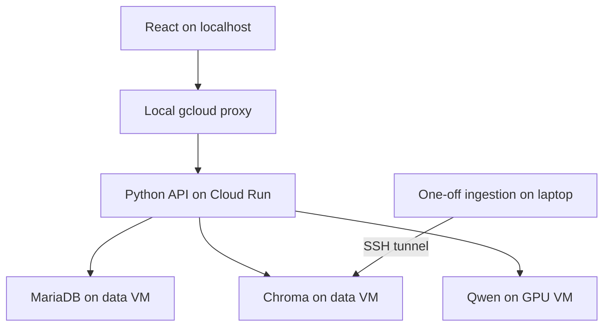

# FitWeLLM — minimal final-project guide

This guide follows Troy Arthur and Jay Michuda's proposal and assumes `gcloud` is installed. The goal is a working class project: profiles, article retrieval, personalized Qwen answers, and citations. Build it locally first, then demonstrate it using the proposed Google Cloud backend and VMs.

**Yes, the webpage can run on localhost.** React runs on your laptop at `http://localhost:5173`. Your browser does not need a public website. For the final cloud demo, `gcloud` forwards your private Cloud Run API to a local port.

This is an implementation guide, not a finished codebase. Steps marked **Build** describe files you still need to write. Infrastructure commands are provided, but have not been run in your Google Cloud account.

## 1. Use this setup

| Component | During development | Final demo |
|---|---|---|
| React | Laptop, localhost:5173 | Same |
| Python API + Protobuf/Connect-RPC | Laptop, localhost:8080 | One Cloud Run service, accessed through a local `gcloud` proxy |
| MariaDB 11.4 | Local Docker container | Docker on the data VM |
| Chroma | Local Docker container | Docker on the same data VM |
| BGE embeddings | Python on laptop | Python in Cloud Run for questions; laptop for ingestion |
| Qwen | Smaller local model if hardware permits | Qwen2.5-3B-Instruct-AWQ with vLLM on the L4 VM |
| Raw articles | Local archive | Copy in the proposed Cloud Storage bucket |
| DB password | Ignored local environment file | Secret Manager, as proposed |

The data VM is `e2-medium` with a 30 GB disk. The model VM is `g2-standard-4` with an L4 GPU and a 60 GB disk, matching the proposal.



### What is necessary, and what changed

- Use **Connect-RPC**, which is already an option in the proposal. Its Python server handles browser requests directly, so there is no separate Envoy service. This selects Connect's Python runtime in place of a standalone `grpcio` server; keep Protobuf and `protoc`.
- Parse **BioC JSON**, because that is what your selected article archive contains. PyMuPDF is unnecessary for this source.
- Use a one-off ingestion script, already allowed by the proposal. A Cloud Run Job is unnecessary.
- Run React locally. No separate frontend Cloud Run service, Nginx deployment, custom domain, or certificate setup.
- Keep Chroma and vLLM behind the VPC firewall. For this trusted two-person demo, omit separate token gateways and the proposed Chroma token. This is a deliberate simplification, not a claim that Chroma automatically authenticates requests.
- Use the VMs' external IPs for outbound downloads and restricted SSH. This avoids adding Cloud NAT and IAP. Database/model traffic still uses internal IPs.

Some implementation dependencies are still needed: a React development server, Python HTTP server, SQL driver, and model libraries. They support the proposed components; they are not additional deployed services.

**Security scope:** use synthetic profiles, keep Cloud Run restricted to your Google accounts, restrict SSH to your public IPs, and never expose database/model ports publicly. A localhost webpage alone does not make remote VMs private. Normal password hashing and profile ownership checks are enough for the proposed login feature; skip OAuth providers, MFA, email verification, and production account-recovery flows.

## 2. Create the project

Use Bash on Linux, macOS, or WSL. Besides `gcloud`, install Python 3.11+, Node.js LTS, Docker, Git, `curl`, and `protoc`.

```bash
mkdir fitwellm
cd fitwellm
git init
mkdir -p proto backend/generated ingestion data/raw data/processed eval
python3 -m venv .venv
source .venv/bin/activate
python -m pip install connectrpc protoc-gen-connectrpc protobuf uvicorn \
  pymysql chromadb sentence-transformers httpx
npm create vite@latest frontend -- --template react-ts
cd frontend
npm install
npm install @connectrpc/connect @connectrpc/connect-web @bufbuild/protobuf
npm install --save-dev @bufbuild/protoc-gen-es
cd ..
```

Use current compatible packages for the first smoke test, then save exact versions with `pip freeze > backend/requirements.txt` and commit the frontend lockfile. Use the same Chroma version in the Python client and Docker server. Connect for Python is currently beta: test a single browser RPC immediately, then keep the working versions fixed.

**Build these files as you work:**

| File | Purpose |
|---|---|
| `proto/fitwellm.proto` | RPCs and message definitions |
| `backend/server.py` | Connect service implementation and ASGI `app` |
| `backend/db.py`, `backend/schema.sql` | Profile/account storage |
| `backend/rag.py` | Retrieval, prompt construction, model request |
| `backend/Dockerfile` | One Cloud Run API image |
| `ingestion/scan.py` | Parse and select candidate articles |
| `ingestion/index.py` | Chunk, embed, and insert approved articles |
| `frontend/src/` | Login, profile form, question form, answers |
| `eval/questions.jsonl` | Small set of evaluation questions |

Ignore `.venv/`, `.env`, `.env.*`, `node_modules/`, model caches, and raw article files in Git. Commit example environment files without passwords.

## 3. Start MariaDB and Chroma locally

Choose a MariaDB root password and a different application password. The application connects as `fitwellm`, not root.

```bash
read -r -s -p 'MariaDB root password: ' MARIADB_ROOT_PASSWORD
printf '\n'
export MARIADB_ROOT_PASSWORD
read -r -s -p 'Application DB password: ' MARIADB_PASSWORD
printf '\n'
export MARIADB_PASSWORD
export CHROMA_VERSION='REPLACE_WITH_INSTALLED_CHROMADB_VERSION'

# View the installed client version before filling CHROMA_VERSION:
python -m pip show chromadb

docker run -d --name fitwellm-db \
  -p 127.0.0.1:3306:3306 \
  -e MARIADB_ROOT_PASSWORD -e MARIADB_PASSWORD \
  -e MARIADB_DATABASE=fitwellm -e MARIADB_USER=fitwellm \
  -v fitwellm-mariadb:/var/lib/mysql mariadb:11.4

docker run -d --name fitwellm-chroma \
  -p 127.0.0.1:8000:8000 \
  -v fitwellm-chroma:/data \
  "chromadb/chroma:$CHROMA_VERSION"
```

This Chroma volume path is for current 1.x images; confirm `/data` is the persistence directory for the version you select. Pin the tested MariaDB image patch/digest for the final demo. Keep passwords in an ignored local file or password manager so you can reuse the application password in Step 9.

Wait until MariaDB reports it is ready. Implement `schema.sql` and apply it before testing profile RPCs. Restart both containers and confirm data persists. Do not recreate/delete volumes just to restart a service.

## 4. Download and prepare articles

Use your exact URL. The `XXXXX` is part of the filename:

```bash
export ARCHIVE_URL='https://ftp.ncbi.nlm.nih.gov/pub/wilbur/BioC-PMC/PMC125XXXXX_json_ascii.tar.gz'
curl --fail --location --retry 5 --continue-at - \
  --output data/raw/PMC125XXXXX_json_ascii.tar.gz "$ARCHIVE_URL"
gzip -t data/raw/PMC125XXXXX_json_ascii.tar.gz
```

The archive was about **9.15 GB compressed** when inspected on November 25, 2026. Download it on a machine with enough disk space, not into a small Cloud Shell home directory. Do not fully extract it onto the 30 GB data VM.

**Important:** the inspected archive member was named `PMC12509531.xml` but contained JSON. Iterate over regular archive members and parse their contents; do not filter only for `.json` filenames.

**Build `ingestion/scan.py`:**

1. Open the archive with `tarfile.open(path, 'r|gz')` to read sequentially.
2. For each regular member, use `archive.extractfile(member)` and `json.load(...)`. Skip/log malformed or excessively large members; do not call `extractall()`.
3. Read `documents`, then each document's `passages`, `text`, and `infons`.
4. Keep PMCID, title, DOI, year, section, license information, and text. Some metadata is in the title passage rather than the document header.
5. Use title/abstract keywords to find candidates about exercise, diet, nutrition, sleep, weight management, or supplements.
6. Save candidates as JSONL and stop after a manageable sample. The archive is not already filtered to wellness.

Start with **20–50 relevant articles**. Manually check their PMC/publisher pages for peer-reviewed publication status, relevance, retractions, and reuse terms. PMC inclusion alone does not prove peer review. Keep a simple CSV with PMCID, source URL, approval decision, review evidence URL, and license. Only approved articles get indexed.

**Build `ingestion/index.py`:**

- Extract narrative text; skip reference lists and boilerplate.
- Split into approximately 350–400 BGE tokens with 50-token overlap.
- Keep the entire embedding input, including a title prefix, within BGE's 512-token limit.
- Embed with `BAAI/bge-small-en-v1.5`; normalize vectors and verify 384 dimensions.
- Insert text, explicit embeddings, and metadata into a cosine-distance Chroma collection named `articles`.
- Use deterministic chunk IDs and upserts so rerunning ingestion does not duplicate chunks.
- Use the same model/revision for indexing and questions. Disable Chroma's default embedding function when supplying vectors yourself.

Store PMCID, title, section, source URL, and a stable chunk ID with every chunk. These are needed for citations. Query five example questions directly against Chroma before connecting the model.

References: [NCBI BioC](https://www.ncbi.nlm.nih.gov/research/bionlp/APIs/BioC-PMC/), [PMC content types](https://pmc.ncbi.nlm.nih.gov/about/intro/), [BGE model card](https://huggingface.co/BAAI/bge-small-en-v1.5).

## 5. Build the API and profile feature

Define package `fitwellm.v1` and service `FitWellness` in `proto/fitwellm.proto`.

| RPC | Behavior |
|---|---|
| `Register`, `Login`, `Logout` | Basic account/session handling from the proposal |
| `CreateProfile`, `GetProfile`, `UpdateProfile`, `DeleteProfile` | Manage the signed-in user's profile |
| `Ask` | Question in; answer and source citations out |

Use a few tables: users, profiles, and sessions. Store password hashes, not plaintext passwords; Python's `hashlib.scrypt` with a random salt can do this without adding an authentication service. Generate random session tokens with `secrets`, store token hashes and expiry times in MariaDB, and invalidate them on logout. Use parameterized SQL.

The frontend keeps its session token in memory and sends it as `x-fitwellm-session`. The backend resolves the user from that token rather than trusting a submitted user ID. The custom header avoids conflicting with the Google authentication header used by the local Cloud Run proxy later.

Store the proposal's profile fields: age, height, weight, optional body fat/conditions, goals, and lifestyle. Label units explicitly. `DeleteProfile` deletes profile data; the login account remains. No separate account-recovery or account-administration subsystem is needed for this demo.

After writing the `.proto` file, generate Python and TypeScript code from the repository root:

```bash
mkdir -p backend/generated frontend/src/gen
protoc -I proto \
  --python_out=backend/generated \
  --connectrpc_out=backend/generated \
  --connectrpc_opt=protobuf=google \
  proto/fitwellm.proto
protoc -I proto \
  --plugin=protoc-gen-es=frontend/node_modules/.bin/protoc-gen-es \
  --es_out=frontend/src/gen --es_opt=target=ts \
  proto/fitwellm.proto
```

Implement the generated Connect service interface and expose its ASGI application as `app` in `backend/server.py`. Use unary requests and binary Protobuf. Follow the [Python Connect guide](https://connectrpc.com/docs/python/getting-started/) and [local code-generation documentation](https://github.com/connectrpc/connect-py). You do not need Buf, Envoy, or a second API server for this route.

After implementing the handlers, start the API locally:

```bash
PYTHONPATH=backend:backend/generated \
  uvicorn server:app --host 127.0.0.1 --port 8080
```

Read database/model settings from environment variables. During local development use DB `127.0.0.1:3306`, Chroma `127.0.0.1:8000`, and an available model endpoint. Implement basic field validation and error responses.

**Checkpoint:** register, log in, create/edit/read/delete a profile, and log out before implementing Ask. Confirm two test users cannot access each other's profiles.

## 6. Build Ask and the localhost UI

**Build `backend/rag.py`:**

1. Read the signed-in user's profile.
2. Embed the question with BGE, using its recommended query prefix: `Represent this sentence for searching relevant passages: `.
3. Retrieve top-k chunks from Chroma. Start with k=5; compare 10 and 15 later.
4. Construct a prompt containing the question, relevant profile fields, and numbered article passages.
5. Call vLLM at `/v1/chat/completions` with the served model name.
6. Return the answer and source metadata through Protobuf.

Tell Qwen to use the supplied evidence, cite passage numbers, explain uncertainty, and say when the corpus cannot answer the question. Treat article/profile text as data rather than instructions. Only allow citation IDs that were actually retrieved.

Start with an 8,192-token model context and 600 output tokens. Count inputs with Qwen's tokenizer and trim evidence to fit. Do not assume that 15 BGE-sized chunks fit into Qwen's prompt. Use a request timeout so an unavailable model does not leave the UI waiting indefinitely.

If your computer can run a smaller Qwen locally, use that for the proposal's local debug stage. Otherwise, test CRUD/retrieval locally and use the GPU VM in Step 10 for real generation. No training or fine-tuning is needed.

**Build the React UI:** login/register, profile form, question box, answer, clickable citations, loading state, and logout. Use only fictional profiles during the demonstration.

Configure Vite in `frontend/vite.config.ts`:

```typescript
import { defineConfig } from 'vite';
import react from '@vitejs/plugin-react';

export default defineConfig({
  plugins: [react()],
  server: {
    host: '127.0.0.1',
    port: 5173,
    strictPort: true,
    proxy: {
      '/rpc': {
        target: 'http://127.0.0.1:8080',
        changeOrigin: true,
        rewrite: (path) => path.replace(/^\/rpc/, ''),
      },
    },
  },
});
```

Create the generated Connect client with `createConnectTransport`, `baseUrl: window.location.origin + '/rpc'`, and `useBinaryFormat: true`. The browser calls Vite on its own origin, and Vite forwards to the API. This avoids separate CORS configuration. See [Connect for Web](https://connectrpc.com/docs/web/getting-started/).

```bash
cd frontend
npm run dev
```

Open **http://localhost:5173**. Later, the same Vite proxy will reach the cloud API through `gcloud` instead of your local Python process.

## 7. Set up the Google Cloud project

Use an existing billing-enabled course project. These commands create billable resources. Verify L4 quota/availability in your chosen zone before relying on it for the demo.

```bash
gcloud auth login
export PROJECT_ID='REPLACE_WITH_PROJECT_ID'
export REGION='us-central1'
export ZONE='us-central1-a'
export BUCKET="${PROJECT_ID}-fitwellm"
export API_SA="fitwellm-api@${PROJECT_ID}.iam.gserviceaccount.com"
export MY_IP_CIDR='REPLACE_WITH_YOUR_PUBLIC_IPV4/32'

gcloud config set project "$PROJECT_ID"
gcloud services enable compute.googleapis.com run.googleapis.com \
  artifactregistry.googleapis.com secretmanager.googleapis.com \
  storage.googleapis.com iam.googleapis.com

gcloud compute networks create fitwellm-net --subnet-mode=custom
gcloud compute networks subnets create fitwellm-subnet \
  --network=fitwellm-net --region="$REGION" --range=10.20.0.0/24

gcloud compute firewall-rules create fitwellm-ssh \
  --network=fitwellm-net --allow=tcp:22 \
  --source-ranges="$MY_IP_CIDR" --target-tags=fitwellm-vm

gcloud compute firewall-rules create fitwellm-api-data \
  --network=fitwellm-net --allow=tcp:3306,tcp:8000 \
  --source-tags=fitwellm-api --target-tags=fitwellm-data

gcloud compute firewall-rules create fitwellm-api-model \
  --network=fitwellm-net --allow=tcp:8000 \
  --source-tags=fitwellm-api --target-tags=fitwellm-model
```

Set `MY_IP_CIDR` to the public IPv4 address of the network you are working from. Include your teammate's `/32` address as another comma-separated source if needed. Update this rule if your address changes. Do not substitute `0.0.0.0/0`.

The custom network has no broad internal allow rule. Only the tagged API can reach the data/model ports; SSH is limited to your addresses. VMs get external IPs by default for outbound downloads, but the firewall does not expose ports 3306/8000 to the internet.

Create storage and the API identity:

```bash
gcloud iam service-accounts create fitwellm-api
gcloud artifacts repositories create fitwellm \
  --repository-format=docker --location="$REGION"
gcloud storage buckets create "gs://$BUCKET" --location="$REGION" \
  --uniform-bucket-level-access --public-access-prevention
gcloud storage cp data/raw/PMC125XXXXX_json_ascii.tar.gz "gs://$BUCKET/raw/"
```

Artifact Registry stores the API container image Cloud Run needs. It is deployment plumbing, not another application component. On later runs, reuse existing resources instead of recreating them.

## 8. Create the data VM

```bash
gcloud compute instances create fitwellm-data --zone="$ZONE" \
  --machine-type=e2-medium --subnet=fitwellm-subnet \
  --private-network-ip=10.20.0.10 \
  --tags=fitwellm-vm,fitwellm-data \
  --no-service-account --no-scopes \
  --image-family=ubuntu-2204-lts --image-project=ubuntu-os-cloud \
  --boot-disk-size=30GB --boot-disk-type=pd-balanced

gcloud compute ssh fitwellm-data --zone="$ZONE"
```

On this VM, install Docker using the [Ubuntu instructions](https://docs.docker.com/engine/install/ubuntu/). Then repeat the MariaDB/Chroma commands from Step 3 with these changes:

- Bind MariaDB to `10.20.0.10:3306:3306` and Chroma to `10.20.0.10:8000:8000`.
- Add `--restart unless-stopped` to both containers.
- Use the same application DB password that you will put in Secret Manager.
- Keep named volumes for persistence. Use `sudo docker` if your user lacks Docker access.

From your laptop, keep an SSH tunnel open in another terminal:

```bash
gcloud compute ssh fitwellm-data --zone="$ZONE" -- \
  -N -L 127.0.0.1:13306:10.20.0.10:3306 \
  -L 127.0.0.1:18000:10.20.0.10:8000
```

Apply your schema through `127.0.0.1:13306`. Run your ingestion script on the laptop against Chroma at `127.0.0.1:18000`. This keeps archive parsing and embedding off the small data VM. Verify the indexed count and one retrieval query.

The internal IP remains attached when stopping/starting the same VM. Recreating the VM requires checking that address again. Watch disk/RAM use as the corpus grows; the proposed VM is intended for a small demonstration corpus.

## 9. Store the API's database password

Use the same application password configured on the data VM:

```bash
read -r -s -p 'Application DB password: ' FITWELLM_DB_PASSWORD
printf '\n'
printf '%s' "$FITWELLM_DB_PASSWORD" | gcloud secrets create fitwellm-db-password \
  --replication-policy=automatic --data-file=-
unset FITWELLM_DB_PASSWORD

gcloud secrets add-iam-policy-binding fitwellm-db-password \
  --member="serviceAccount:$API_SA" --role=roles/secretmanager.secretAccessor
```

The root password stays with the VM administrator. No Chroma token or model API key is needed for this restricted demo network. No cloud service-account key files are needed.

## 10. Create the GPU VM and start Qwen

```bash
gcloud compute instances create fitwellm-model --zone="$ZONE" \
  --machine-type=g2-standard-4 --subnet=fitwellm-subnet \
  --private-network-ip=10.20.0.20 \
  --tags=fitwellm-vm,fitwellm-model \
  --no-service-account --no-scopes \
  --image-family=ubuntu-2204-lts --image-project=ubuntu-os-cloud \
  --boot-disk-size=60GB --boot-disk-type=pd-balanced \
  --maintenance-policy=TERMINATE

gcloud compute ssh fitwellm-model --zone="$ZONE"
```

On the VM:

1. Install the compatible [NVIDIA driver](https://docs.cloud.google.com/compute/docs/gpus/install-drivers-gpu) and reboot if required.
2. Confirm `nvidia-smi` shows the L4.
3. Install Docker and [NVIDIA Container Toolkit](https://docs.nvidia.com/datacenter/cloud-native/container-toolkit/latest/install-guide.html), including configuring the Docker runtime.
4. Select a tested vLLM image version and launch the model:

```bash
export VLLM_IMAGE='vllm/vllm-openai:REPLACE_WITH_TESTED_TAG'
sudo docker run -d --name fitwellm-model --restart unless-stopped \
  --gpus all --ipc=host \
  -p 10.20.0.20:8000:8000 \
  -v fitwellm-model-cache:/root/.cache/huggingface \
  "$VLLM_IMAGE" \
  --model Qwen/Qwen2.5-3B-Instruct-AWQ \
  --served-model-name fitwellm-qwen \
  --quantization awq --dtype half \
  --max-model-len 8192 --gpu-memory-utilization 0.8 \
  --host 0.0.0.0 --port 8000
```

Wait for model loading to finish. Test an actual chat completion, not just GPU visibility. The cache keeps weights on the VM as proposed; a duplicate model-weight upload is not necessary for the demo. Record the model revision used for the final evaluation.

For local API testing against this VM, open another laptop terminal:

```bash
gcloud compute ssh fitwellm-model --zone="$ZONE" -- \
  -N -L 127.0.0.1:18001:10.20.0.20:8000
```

Set the local API's model URL to `http://127.0.0.1:18001/v1` and model name to `fitwellm-qwen`. The cloud API later uses the internal address instead.

References: [Qwen model](https://huggingface.co/Qwen/Qwen2.5-3B-Instruct-AWQ), [vLLM serving](https://docs.vllm.ai/en/latest/getting_started/quickstart/).

## 11. Deploy one Python API to Cloud Run

**Build `backend/Dockerfile`.** It must install your requirements, include the application/generated code and BGE model, set `PYTHONPATH`, and run Uvicorn on `0.0.0.0:8080`. Only the local development process binds to loopback; Cloud Run requires the container listener on all interfaces.

Ensure the application reads these variables: `DB_HOST`, `DB_PORT`, `DB_NAME`, `DB_USER`, `DB_PASSWORD`, `CHROMA_HOST`, `CHROMA_PORT`, `CHROMA_COLLECTION`, `LLM_BASE_URL`, and `LLM_MODEL`. Load BGE once per process, not once per request.

From the repository root on your laptop:

```bash
export IMAGE="${REGION}-docker.pkg.dev/${PROJECT_ID}/fitwellm/api:demo-v1"
gcloud auth configure-docker "${REGION}-docker.pkg.dev"
docker buildx build --platform linux/amd64 --push \
  -f backend/Dockerfile -t "$IMAGE" .

gcloud run deploy fitwellm-api --image="$IMAGE" --region="$REGION" \
  --service-account="$API_SA" \
  --port=8080 --cpu=2 --memory=2Gi \
  --min-instances=0 --max-instances=1 --concurrency=2 --timeout=180 \
  --network=fitwellm-net --subnet=fitwellm-subnet \
  --network-tags=fitwellm-api --vpc-egress=private-ranges-only \
  --ingress=all --no-allow-unauthenticated \
  --set-secrets=DB_PASSWORD=fitwellm-db-password:1 \
  --set-env-vars='DB_HOST=10.20.0.10,DB_PORT=3306,DB_NAME=fitwellm,DB_USER=fitwellm,CHROMA_HOST=10.20.0.10,CHROMA_PORT=8000,CHROMA_COLLECTION=articles,LLM_BASE_URL=http://10.20.0.20:8000/v1,LLM_MODEL=fitwellm-qwen'
```

The command assumes secret version `1` from Step 9. Use the actual version if you added more. Use a new image tag when rebuilding. Check memory use if the embedding model pushes the API above 2 GiB.

Keep normal ingress so the local proxy can reach the service; IAM authentication restricts who can call it. Setting ingress to `internal` would block your laptop. Direct VPC egress is for the API's outbound connection to the VMs.

Grant each teammate Cloud Run invocation access; repeat with the second email:

```bash
export TEAMMATE_EMAIL='REPLACE_WITH_GOOGLE_ACCOUNT_EMAIL'
gcloud run services add-iam-policy-binding fitwellm-api --region="$REGION" \
  --member="user:$TEAMMATE_EMAIL" --role=roles/run.invoker
```

The deploying account also needs resource creation/deployment permissions, and each teammate may need Cloud Run read access to discover the service. If your course manages IAM, have the administrator grant those permissions. Do not grant public `allUsers` access. If reusing a service made public by the old guide, remove that existing `allUsers` invoker binding and restore its IAM invoker check before using this setup.

## 12. Run the cloud project from localhost

Stop your local Python API so port 8080 is available.

**Terminal 1 — authenticate the cloud connection:**

```bash
gcloud auth login
gcloud run services proxy fitwellm-api \
  --project="$PROJECT_ID" --region="$REGION" --port=8080
```

**Terminal 2 — run the webpage:**

```bash
cd frontend
npm run dev
```

Open **http://localhost:5173**. Vite sends `/rpc` requests to the local `gcloud` proxy, which attaches your Google credentials and calls Cloud Run. The API connects to MariaDB, Chroma, and Qwen through the VPC. Your app session travels separately in `x-fitwellm-session`.

Your teammate runs the same frontend and proxy on their own laptop using their own Google account. Keep both local servers bound to localhost. The SSH tunnels from Steps 8/10 are only needed for direct development/ingestion; the final Cloud Run workflow does not require them.

Google documents this workflow in [`gcloud run services proxy`](https://docs.cloud.google.com/sdk/gcloud/reference/run/services/proxy). It is a local development tool, not an extra deployed service.

## 13. Test what the proposal promises

Prepare approximately 15–20 cases from the approved articles. Keep some aside while tuning so you have a small final test set.

| Test | What to check |
|---|---|
| Profile CRUD | Values persist; updates/deletion work |
| Two accounts | Each account accesses only its own profile |
| Answerable questions | Retrieved articles and answer match the source evidence |
| k=5, 10, 15 | Which setting gives the best useful evidence within the token budget? |
| Unsupported questions | Model explains that the available evidence is insufficient |
| Same question, different profiles | Answer reflects the changed relevant attributes |
| Citations | Every citation opens an approved article and supports the claim |
| End-to-end timing | Record retrieval/generation/total time for the final setup |

Save a small table of question, expected evidence, actual answer, citations, pass/fail, and latency. Manually inspect claim support. Run the final cases on the deployed Qwen 3B model, as proposed.

For debugging:

```bash
gcloud run services logs read fitwellm-api --region="$REGION" --limit=50
```

On a VM use `sudo docker logs CONTAINER_NAME`. Log request IDs, timings, and errors rather than passwords or full profiles. A successful health check alone does not prove the complete browser-to-model workflow works.

## 14. Stop resources when finished

```bash
gcloud compute instances stop fitwellm-model fitwellm-data --zone="$ZONE"
```

For the next session:

```bash
gcloud compute instances start fitwellm-model fitwellm-data --zone="$ZONE"
```

Wait for the containers and model to become ready before opening the demo. Disks, stored images/data, and some network resources can still cost money while VMs are stopped. After submission, save your results and delete the project resources you no longer need. Delete the whole project only if it is dedicated to this assignment.

## Done means

- React runs on localhost and reaches the cloud API.
- Login and profile create/read/update/delete work.
- Relevant, approved peer-reviewed articles are in Chroma.
- Qwen answers using retrieved passages and the current profile.
- Answers include traceable citations and handle unsupported questions.
- A small evaluation table and architecture explanation are ready for submission.

This preserves the project's main components without building a public production service. Update the report's implementation notes to explain the JSON source, local React hosting, Connect runtime choice, and omitted Chroma token layer.

